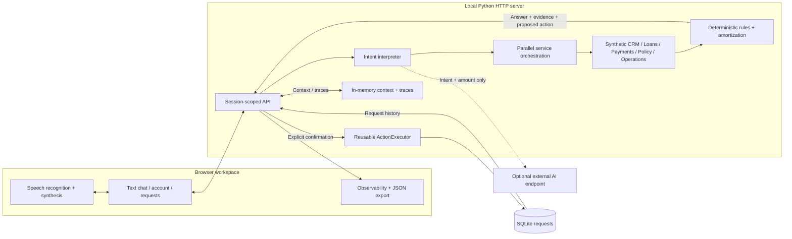

# Blue · Enterprise AI loan servicing

A runnable prototype for the Blue Machines FDE Leader engineering challenge: customer-specific servicing answers, text and browser voice interaction, deterministic prepayment calculations, confirmed service requests, and a shared execution capability demonstrated across loans and credit cards.

**Runs locally with Python’s standard library. No package installation, database setup or API key required for demo mode.** All accounts, transactions and policies are synthetic. The default query interpreter is deterministic; an optional external AI adapter can interpret intent without controlling calculations or writes.

## Start in one minute

Requires Python 3.9 or later. Chrome is recommended for microphone support.

```sh
cd blue-servicing
python3 server.py
```

Open [http://localhost:8080](http://localhost:8080). Start with **Understand my EMI**, then ask **What if I prepay ₹50,000?** and **What about ₹20,000 instead?** Review and confirm a request, then check **Service requests**.

For voice, click the microphone and grant microphone permission. The audio control toggles spoken replies. Browser recognition availability varies; a working microphone session must be verified on the demonstration machine.

## Expected deliverables

| Deliverable | Implementation and evidence | Verification boundary |
| --- | --- | --- |
| **1. Working application** | Responsive web workspace; EMI explanation, prepayment and payment-review journeys; browser speech recognition and synthesis. [Demo guide](docs/DEMO.md) | Text and action flows browser-checked. Real microphone conversation requires manual verification. |
| **2. Functional backend** | Python HTTP API, parallel CRM/Loans/Payments/Policy/Operations mocks, account-specific rules and calculations, confirmed writes. [Backend](blue-servicing/server.py) | Default router has bounded intents. Optional live AI provider is not exercised in committed evidence. |
| **3. Reusable component** | [ActionExecutor](blue-servicing/actions.py): preparation, confirmation, customer scoping, idempotency and persistence; used by loan servicing and card disputes. [Reuse explanation](docs/ARCHITECTURE.md#reusable-platform-capability) | Two workflows use the same implementation and tests. |
| **4. Performance evidence** | [Measured local results](docs/PERFORMANCE.md), [raw samples](blue-servicing/performance.json), live backend traces and browser timing dashboard with JSON export. | Synthetic local services; no 1,000-session or live voice latency claim. |
| **5. Technical explanation** | [Architecture, decisions and trade-offs](docs/ARCHITECTURE.md), including production evolution and security boundaries. | Implemented architecture is distinguished from proposed production changes. |
| **6. Source code** | Full application, tests, CI, [configuration and operational instructions](blue-servicing/README.md). | No credentials or local SQLite data are committed. |

## Architecture



Detailed runtime and confirmation diagrams: [architecture document](docs/ARCHITECTURE.md) and [application README](blue-servicing/README.md#architecture-and-reuse).

## Validate

```sh
cd blue-servicing
PYTHONDONTWRITEBYTECODE=1 python3 -m unittest -v
# Optional JavaScript syntax check if Node.js is installed:
node --check static/app.js
# In another terminal while the server is running:
python3 verify_http.py
```

The HTTP verifier creates synthetic requests and refreshes `performance.json`. CI repeats unit tests, JavaScript syntax validation and HTTP checks, and uploads its own performance artifact. A local test result does not imply GitHub CI has run.

## Optional AI configuration

Set `AI_ENDPOINT` to an OpenAI-compatible chat-completions URL, `AI_MODEL` to the provider’s model identifier, and `AI_API_KEY` if required. Restart the server. Configuration is read from the process environment; `.env` files are not loaded automatically. See [full configuration instructions](blue-servicing/README.md#ai-mode-optional).

Only the current synthetic message and prior intent/amount go to the configured provider. Facts, calculations and confirmed requests remain controlled by backend code. Without configuration, the visible engine label identifies demo routing; provider errors select the labeled fallback.

## Scope and limitations

This is a local enterprise product prototype. Integrations are in-process mocks, identity is a fixed synthetic customer, and the server binds to loopback. Requests persist in SQLite; conversation context and traces reset on restart. A service request is a persisted review record, not an actual bank transaction. No production authentication, external account connection, public application deployment or concurrency certification is included. Browser speech services may send audio to the browser vendor.

The repository is designed to be public; do not add real customer data, API keys, `.env` files or database files.
