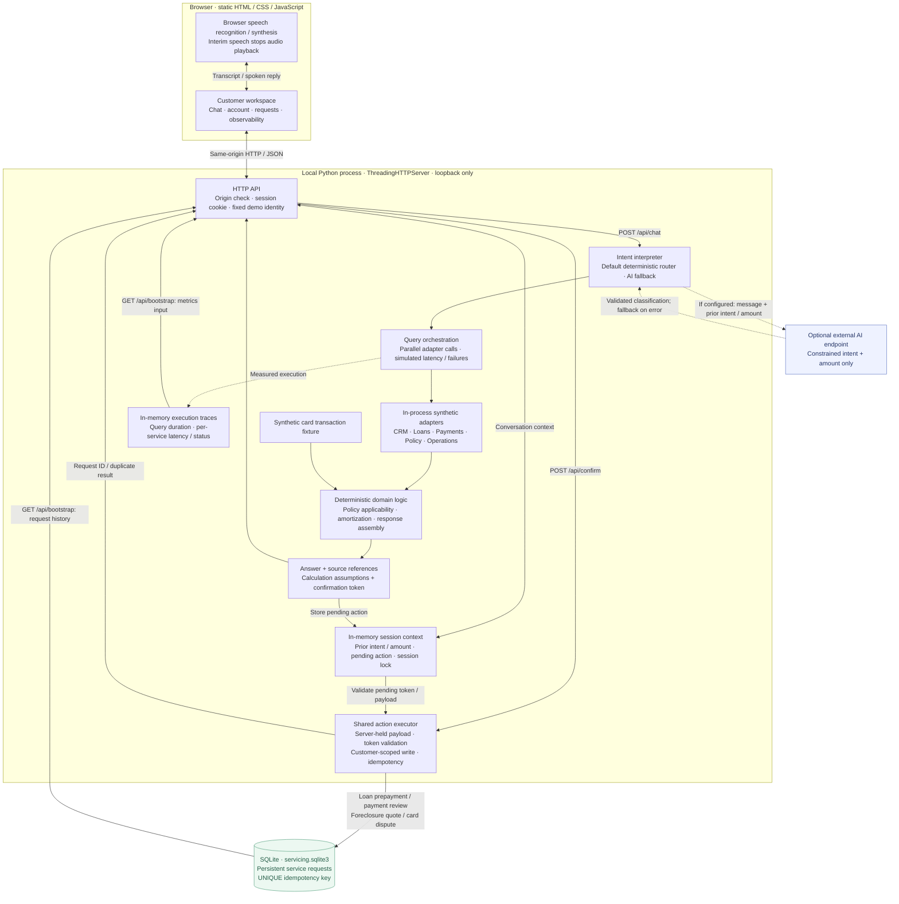

# Blue — enterprise servicing prototype

A working local product demo for the Blue Machines FDE assignment. No installation or paid services required. All customers, transactions and policies are synthetic; account state is fixed at 26 October 2026.

## Run

Python 3.9+:

```sh
cd blue-servicing
python3 server.py
```

Open http://localhost:8080. Set `PORT` to change the port. The server binds loopback only. SQLite creates `servicing.sqlite3` automatically; restart preserves requests. Session conversation context and recent traces are in memory.

## Demo script

1. Click **Understand my EMI**: rate-reset evidence and historical schedule comparison.
2. Ask **What if I prepay ₹50,000?**, then **What about ₹20,000 instead?**: compare deterministic savings and term reduction.
3. Click **Review prepayment request**, confirm, and open **Service requests**: persisted request, no actual money movement.
4. Ask **Show my failed payments in the last six months**, then create a payment review.
5. Select **Credit card** and ask about an unrecognized transaction: the same tokenized action executor creates a card dispute.
6. Open **System observability**, enable Payments failure, then ask about payments. Observe a safe failure with no fabricated status. Slow-service mode multiplies simulated delays by five.

## Voice

Use Chrome on localhost with microphone permission. Tap the microphone to start/stop recognition; the sound control toggles spoken replies. Recognition is continuous and interim speech cancels playback to support interruption. Speech depends on browser/vendor availability and may use the browser vendor’s cloud service. Headphones reduce speech-output feedback into recognition. The current implementation does not provide a production duplex media pipeline, server-side VAD or validated voice latency measurements. During a busy backend request, a new utterance remains in the input for explicit submission.

## AI mode (optional)

The default is an explicitly labeled deterministic intent router, making the prototype runnable without keys. This is not unrestricted conversational AI. To enable model-backed intent interpretation, configure an OpenAI-compatible chat-completions endpoint on the server:

```sh
export AI_ENDPOINT='https://your-provider.example/v1/chat/completions'
export AI_MODEL='your-model-id'
# Set AI_API_KEY in your environment if your endpoint needs authorization.
python3 server.py
```

The adapter sends the current synthetic user message and prior intent/amount to the configured endpoint. No key reaches the browser. The model returns a constrained intent and amount; code retrieves facts, computes results and authorizes writes. On model error the deterministic router takes over with a visible fallback label. The external adapter has not been exercised against a live provider in this environment.

## Architecture and reuse

Browser → threaded Python HTTP server → intent interpreter → parallel synthetic service adapters → deterministic rule/calculation functions → response with source references and measured trace.



The diagram reflects the implemented prototype: adapters run inside the Python process, and voice runs in the browser. Query responses prepare actions; only a separate, explicit confirmation reaches the shared executor. Both loan servicing and card disputes use that executor. SQLite survives server restarts; sessions and traces do not. Source references identify seeded records and rules, rather than retrieved document passages.

Reusable execution is implemented independently in `actions.py`; `test_actions.py` verifies reuse across domains, persistence, idempotency and token isolation.

Five service domains: CRM, Loans, Payments, Policy, Operations. These are in-process mock adapters with varied latency, rather than separately deployed HTTP services. SQLite backs Operations. The small card scenario has a synthetic transaction fixture and uses the same action executor as loan servicing. Current policy references are hand-seeded; no vector database is required for this bounded dataset.

Action execution: server-held pending payload → opaque confirmation token → customer-scoped SQLite write with a UNIQUE idempotency key. A new question invalidates the previous pending action. A retry returns the existing request ID. Origin checks and HttpOnly/SameSite session cookies protect the local prototype. This is a fixed demo identity, not production authentication; requests share CUS-1024 across sessions. Observability is demo-wide. Do not expose this server publicly with real data.

Calculation: monthly amortization with final payment adjusted. The term-reduction option retains the unrounded calculated EMI; the alternative EMI reduction retains 42 months. Amounts are displayed to two decimal places in answers. No daily accrued interest, real lender fees, dates or settlement accounting. Synthetic policy deliberately specifies zero prepayment fees. Actual financial calculations would use contract-specific decimal rounding and settlement conventions.

## Performance instrumentation

The observability view records backend query and per-service latency, typed-turn round trip, and real final-transcript-to-first-audio samples when browser speech starts. Interruption timing measures cancellation API dispatch, not actual audible silence. Download JSON evidence from the dashboard. Browser timing samples are session-scoped and in memory. `performance.json` records reproducible HTTP normal/slow/failure phases; voice measurements remain explicitly unrecorded until a real microphone test.

## Verification

```sh
PYTHONDONTWRITEBYTECODE=1 python3 -m unittest -v
# With the server running (creates two synthetic test requests):
python3 verify_http.py
node --check static/app.js
```

Unit tests check amortization, independently derived interest savings, invalid inputs, follow-up context, service-failure behavior, second-product reuse and stale confirmations. HTTP checks verify cross-session confirmation protection, persistent actions, idempotency and failures. `performance.json` captures measured local samples and conditions. UI prepayment/confirmation/request-history flows were verified in the in-app browser; real microphone behavior requires user microphone access and has not been end-to-end verified.

## Production evolution and trade-offs

This is a local working prototype, not a completed production assignment submission. No load claim is made for 1,000 concurrent sessions. Replace in-memory sessions with shared storage; add authenticated identity and per-tool authorization, asynchronous orchestration and bounded connection pools, durable audit/event queues, provider streaming and dedicated real-time voice transport, policy ingestion/version selection, encryption and retention controls. Instrument end-of-speech to first-audio and interruption latency separately from server query latency. Bound retries and use circuit breakers for external APIs. Scale/load-test against actual model, voice and downstream quotas before sizing workers.

See the [submission deliverables](../README.md), [technical explanation](../docs/ARCHITECTURE.md), [performance report](../docs/PERFORMANCE.md), and [review demo](../docs/DEMO.md).

The backend is Python and SQLite, so this version is served locally rather than published to Sites' Worker runtime. Public hosting would require a backend deployment or a Worker-compatible port with durable storage.
