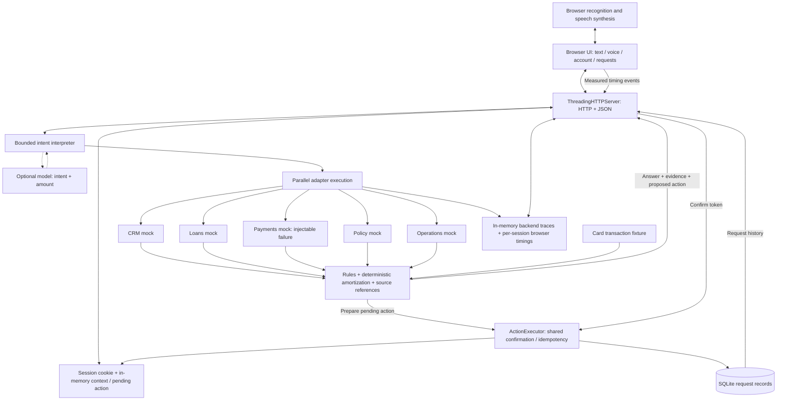
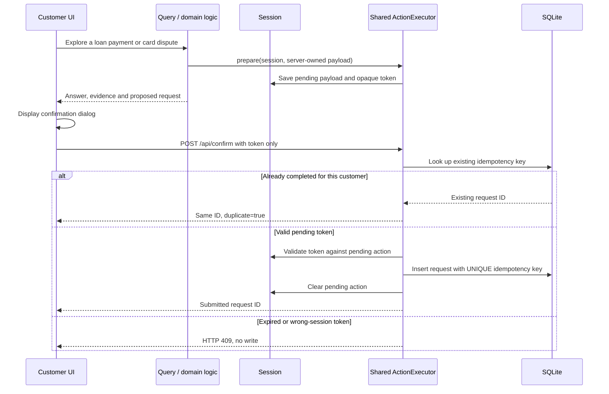

# Architecture and engineering decisions

## Runtime boundary

The implementation consists of a buildless browser application and a Python standard-library HTTP server. The server serves static assets and same-origin JSON APIs. The synthetic account is dated 26 October 2026. Five domain adapters execute inside the server process; they are not independent microservices.

## Query lifecycle

1. Resolve the opaque session cookie. Every session currently uses the same explicit demo identity, CUS-1024.
2. Interpret the message using deterministic routing or the optional model adapter. The external model returns only a constrained intent and optional amount; it never supplies executable actions or authoritative account facts.
3. Select and call the necessary synthetic domain adapters in parallel. Their latency varies. The UI can request a slower mode or a Payments failure.
4. Compute financial results in code. The prepayment calculator builds a monthly amortization schedule and adjusts the last instalment.
5. Assemble the answer, source identifiers, assumptions and per-service trace. Missing payment data yields an explicit failure rather than an inferred status.
6. When relevant, prepare a pending action. A fresh conversational query replaces or invalidates the previous pending action.

The EMI explanation uses a recorded change from 10.5% to 11.5% with comparable schedule snapshots. Seeded policy references are not document retrieval citations. Some explanation text is templated for this bounded dataset; broad policy reasoning and arbitrary document questions are outside current scope.

## Reusable platform capability

`blue-servicing/actions.py` has no dependency on loan calculations, card facts, speech or HTTP. Its contract is:

- `prepare(session, payload)` creates an opaque token for a server-owned action.
- `confirm(session, token)` validates the pending token, persists one request and returns its ID.
- `history(customer)` reads persisted customer-scoped requests.

Loan prepayments, payment reviews, foreclosure quotes and credit-card disputes all use this implementation. To introduce another workflow, add domain facts/rules that construct a server-owned payload; the confirmation API, persistence, retry behavior and history UI do not change. This is practical reuse of a bounded execution capability, not a generalized workflow engine.

The client sends only a confirmation token, never an authoritative action amount. The server supplies the stored payload. A per-session lock serializes operations. The unique database key prevents duplicate inserts. Synthetic service requests do not move money.

## API surface

| Method | Path | Purpose |
| --- | --- | --- |
| GET | `/api/bootstrap` | Account summary, customer request history, demo-wide backend traces and current-session browser timings |
| POST | `/api/chat` | Message, workflow (`loans` / `cards`), slow/failure switches; returns answer, evidence, result, action and trace |
| POST | `/api/confirm` | Confirm a server-prepared action using its token |
| POST | `/api/telemetry` | Record allowlisted numeric timing samples, with bounded history |

## State and security

- **SQLite:** durable synthetic service requests. `DATABASE_PATH` optionally selects an isolated database for verification.
- **Memory:** session context, locks, pending actions and bounded trace samples. Sessions are process-local and have no expiry policy in this demo.
- **Browser:** current transcript and audio state; no server API key is exposed.
- **Controls:** same-origin check on requests with an Origin header; HttpOnly/SameSite cookies; server-owned action payload; parameterized SQL; request-size and message-length limits.
- **Limits:** fixed demo identity rather than authentication; all sessions see CUS-1024 history; backend traces are demo-wide; no public-host hardening or tenant isolation claim. Keep loopback binding and synthetic data.

## Voice and measurement

Speech recognition and synthesis run in the browser. Interim recognition and speech-start events cancel current playback. New final utterances made while a backend request is active remain available in the composer for submission. This is not a full-duplex voice transport or a general cancellation protocol for in-flight actions.

The browser records typed-turn round trip, final-transcript-to-first-audio when speech actually starts, and the duration of dispatching the cancellation API call after a speech-start event. Cancel dispatch is not proof of audible silence. These metrics are visible and exportable; committed measurements distinguish recorded samples from unverified voice paths.

## Decisions and trade-offs

| Decision | Benefit within the exercise | Trade-off |
| --- | --- | --- |
| Standard-library Python + buildless JS | One-command launch, no installation friction | Thread-per-request and compact modules are not the production deployment design |
| Deterministic calculations and action ownership | Reproducible numbers and controlled mutations | Bounded scenarios and explicit assumptions |
| Optional constrained AI interpretation | Allows model integration while preserving authority in code | Live provider still needs configuration and evaluation |
| In-process service mocks | Repeatable failure/latency demonstrations without external accounts | Does not validate network-level enterprise integrations |
| SQLite | Durable actions and uniqueness constraints with zero setup | A single-node database, not a distributed workflow store |
| Browser speech APIs | Rapid demonstration of text/voice reuse | Browser availability, speech vendor behavior, feedback and interruption limitations |
| Explicit confirmation | Inspectable boundary before state change | One additional interaction before a service request |

## Evolution toward 1,000 concurrent conversations

This is a proposed path, not measured capacity:

1. Move session context and pending actions to a shared store; use authenticated customer and tenant identity.
2. Replace per-request executor creation with bounded asynchronous HTTP clients and connection pools. Apply deadlines, circuit breakers, controlled retries and downstream bulkheads.
3. Put confirmed workflows on a durable queue with an outbox; retain idempotency across retries and worker restarts.
4. Use a managed transactional database and append-only audit events with retention controls.
5. Replace browser-dependent speech with a streaming media gateway, VAD, echo handling and explicit turn cancellation. Budget model and speech quotas separately.
6. Add structured policy applicability, contract-specific decimal financial calculations, evaluation datasets, and restricted tool permissions.
7. Load-test a realistic mix of text/voice sessions, turn frequency, downstream latency and failures. Size by active turns and provider limits, not open-session count alone.
